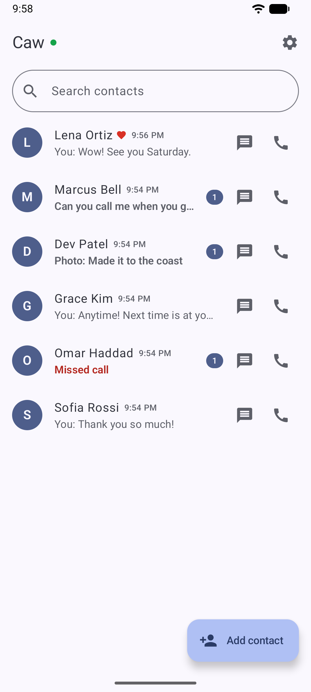

# Caw

Private, self-hosted, ephemeral audio calls and messages. End-to-end encrypted.

- Open source: released under the GNU Affero General Public License v3.0.
- Self-hosted: your server, your accounts, your data.
- Ephemeral: messages expire on a configurable schedule. No message or call history is retained.
- End-to-end encrypted: messages and calls are accessible only to their participants.
- Web and Android: available as a web application and an Android app, with support for multiple devices.

[More screenshots](docs/screenshots.md)

## How it works

- Host your own server for yourself, your friends, or your community.
- Account information is private. Contacts are added with a code, scanned as a QR code in person or shared online as an image or text.
- Contacts can be on the same server or on different servers.
- Messages, photos and videos are encrypted on the sender's device and can be read only on the devices of the two people in the conversation. Servers delete them when they expire.
- Calls are encrypted between the two devices.
- Signing in on another device brings your contacts with it, and your other devices are notified when a new device signs in.
- The Android app receives calls and messages while closed through a push app such as ntfy.

## Getting started

- Run a server: [hosting guide](docs/hosting.md).
- Use the web app: open your server's address in a browser.
- Build the Android app: [android/README.md](android/README.md).

## Documentation

| document | contents |
|---|---|
| [Screenshots](docs/screenshots.md) | Android app |
| [White paper](docs/whitepaper.md) | design and security |
| [Protocol specification](docs/protocol.md) | formats and behavior for compatible clients and servers |
| [API reference](docs/api.md) | server endpoints and WebSocket events |
| [Hosting](docs/hosting.md) | installation, configuration, ports and backups |
| [Development](docs/development.md) | repository layout, building and testing |

## License

AGPL-3.0-or-later, see [LICENSE](LICENSE).
