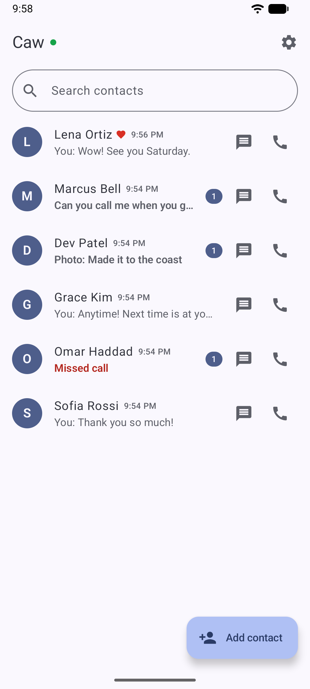
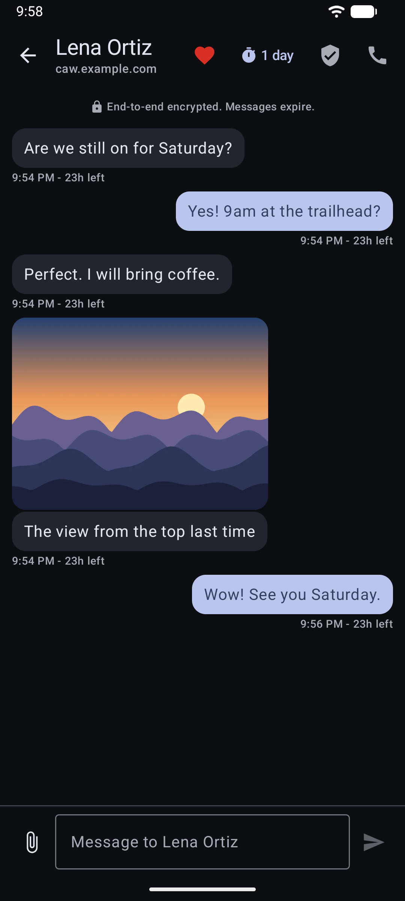
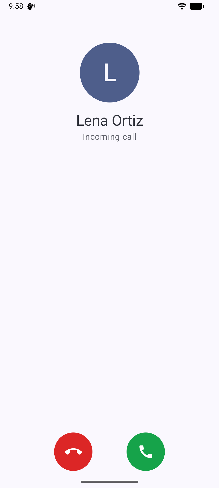
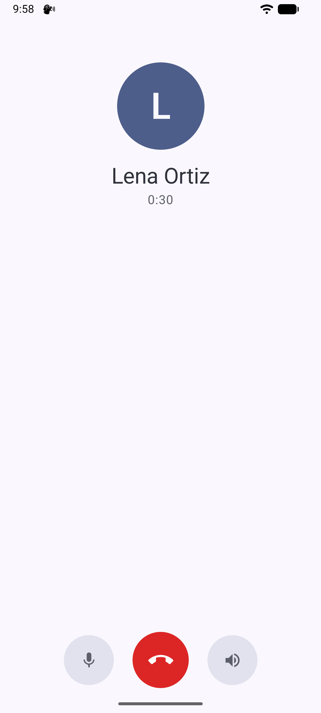
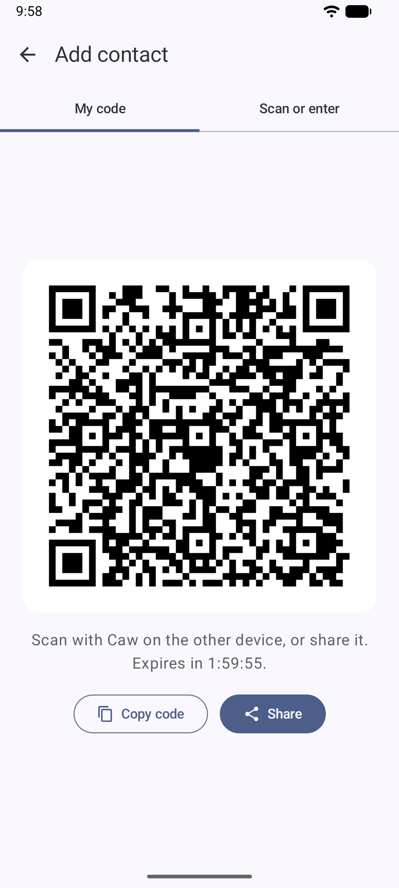
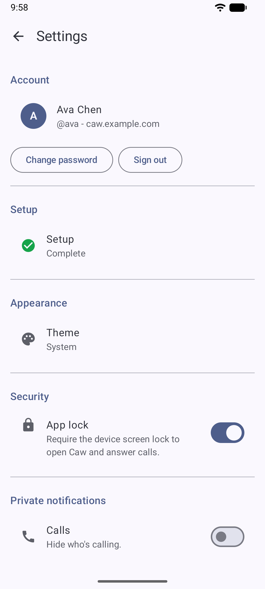

# Screenshots

Android app.

<table>
<tr>
<td align="center"> Contacts</td>
<td align="center"> Conversation, dark theme</td>
<td align="center"> Incoming call</td>
</tr>
<tr>
<td align="center"> Call</td>
<td align="center"> Add contact</td>
<td align="center"> Settings</td>
</tr>
</table>
